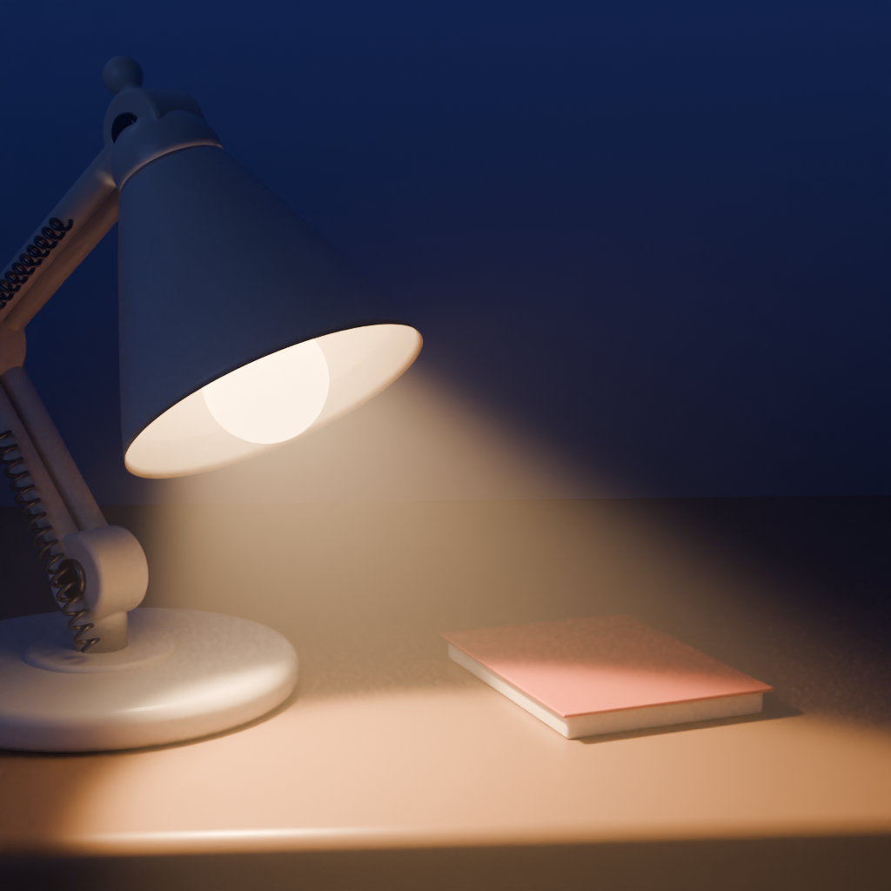

# Lamplight



A tiny macOS menu bar app that keeps your Mac awake. The menu bar icon is a desk lamp whose beam ages over a long session: it dims after 3 hours and breaks up into flickering bands after 6 hours.


## Features

- Left-click the menu bar icon to turn keep-awake on or off.
- Right-click or Control-click to open the menu.
- Keep Awake For: indefinitely, 5 minutes, 15 minutes, 30 minutes, 1 hour, 2 hours, or 5 hours. The menu shows the time remaining.
- Allow Display Sleep: let the screen sleep while the Mac stays awake.
- Launch at Login.

## Requirements

macOS 14 or later.

## Build from source

```sh
brew install xcodegen
xcodegen generate
```

Then open `Lamplight.xcodeproj` in Xcode, or run:

```sh
scripts/install.sh
```

`scripts/install.sh` builds a Release build and installs it to `/Applications`, ad-hoc signed, then launches it.

## Prebuilt copies

Builds are not notarized. If you download a prebuilt copy, macOS blocks the first launch. Open System Settings, go to Privacy & Security, and click Open Anyway.

## How it works

Lamplight holds an IOKit `PreventUserIdleSystemSleep` power assertion, plus a display-sleep assertion unless Allow Display Sleep is on. The app is sandboxed, has no network access, and collects nothing.

## Credits

The app icon was rendered in Blender from `design/app-icon/awake_icon.py`.

## License

MIT. See [LICENSE](LICENSE).
